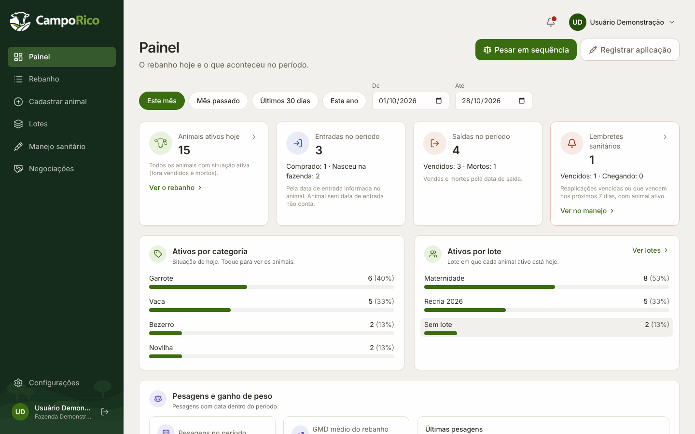
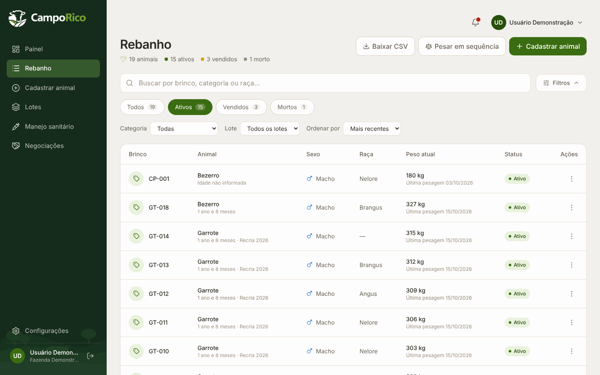
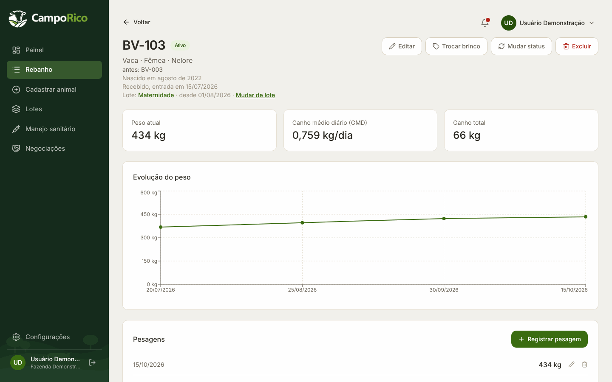
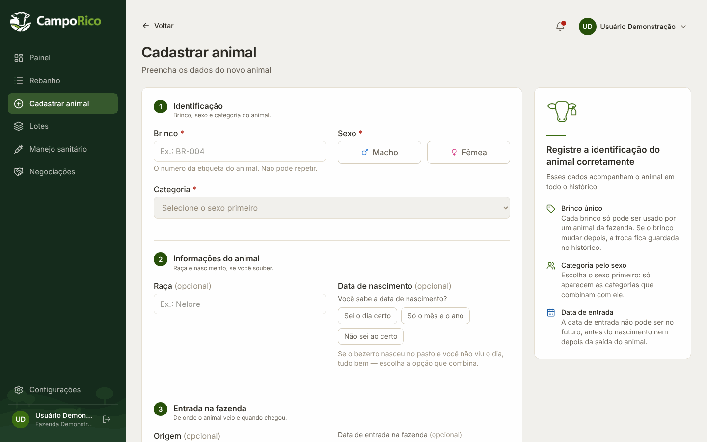
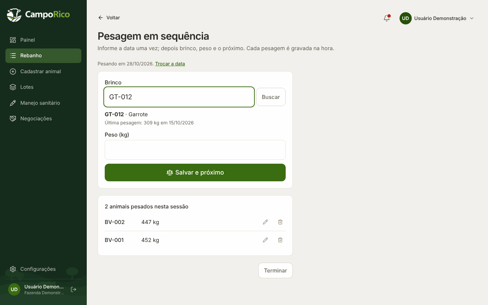
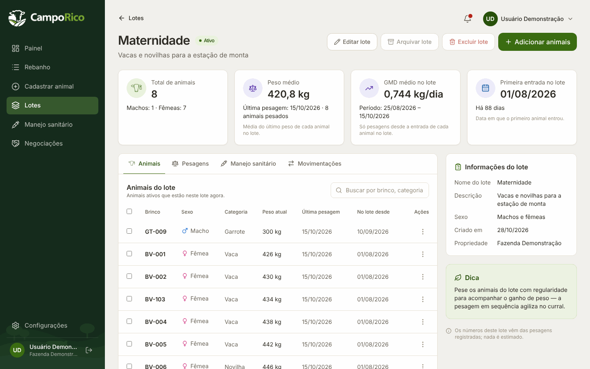
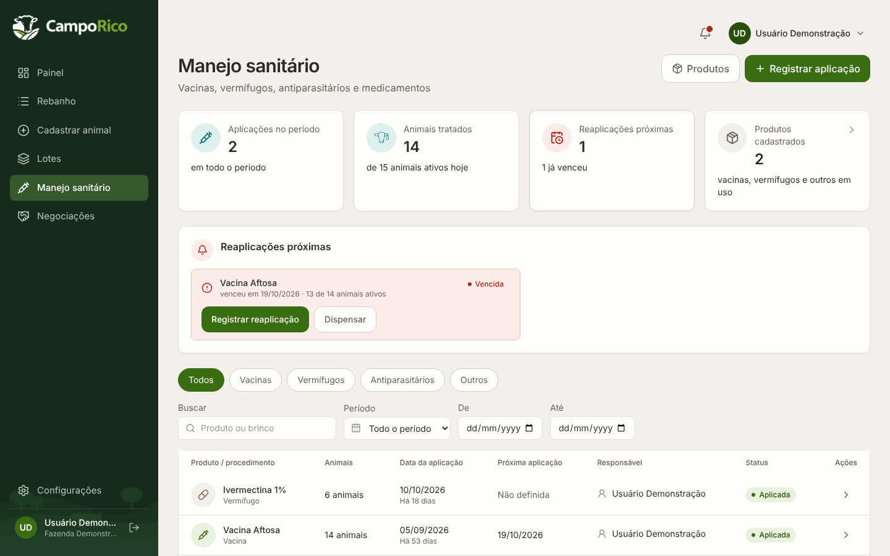
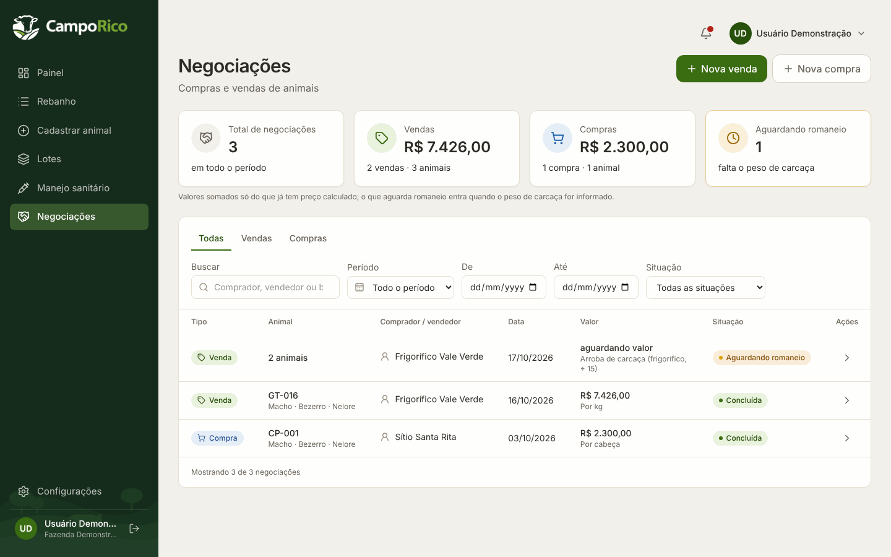
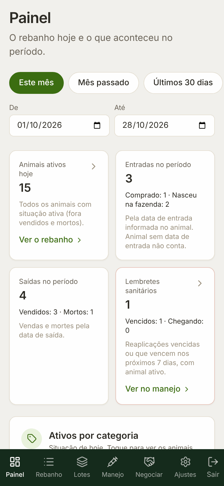
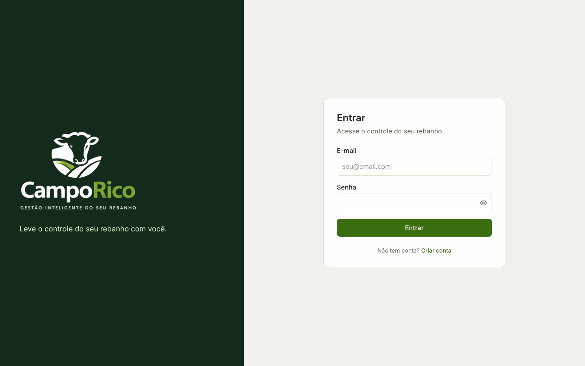

<p align="center">
  <picture>
    <source media="(prefers-color-scheme: dark)" srcset="web/public/brand/camporico-full-dark.png">
    
  </picture>
</p>

<h1 align="center">Rebanho</h1>

<p align="center">
  Gestão de gado de corte: animais, pesagens, lotes, manejo sanitário e negociações em um só lugar.
</p>

---

## Sobre o projeto

O **Rebanho** é um sistema web (SaaS) para a gestão de rebanhos de gado de corte, desenvolvido
dentro da proposta da TG Campo — Tecnologia e Gestão para o Campo.

Em muitas fazendas, as informações do rebanho ficam espalhadas em cadernos, planilhas e na
memória de quem trabalha no curral. Com isso, fica difícil responder perguntas simples do dia a
dia: quantos animais estão ativos, quanto cada um ganhou de peso, qual lote precisa de
vacina, quanto uma venda rendeu em relação à compra.

O Rebanho organiza esses registros por fazenda e transforma o histórico de cada animal em
informação para decidir: o que está acontecendo no rebanho, o que precisa de atenção e o que
fazer agora.

**Para quem:** pecuaristas, gerentes de fazenda e equipes que registram a rotina de manejo,
tanto no escritório quanto no celular.

**Estágio atual:** em desenvolvimento ativo, ainda **não publicado para uso**. O código roda
localmente e conta com testes automatizados; não há ambiente público de demonstração.

## O que o sistema faz hoje

Todas as funções abaixo estão implementadas no código (API e telas). As rotas da API têm testes
automatizados de integração com banco de dados real.

**Rebanho e animais**
- Cadastro de animais com brinco único por fazenda, sexo, raça, data de nascimento, categoria,
  origem e data de entrada.
- Categorias ligadas ao sexo (bezerro ou bezerra, novilha, vaca, garrote, boi, touro), com nomes
  personalizáveis pela fazenda.
- Troca de brinco com histórico (a busca encontra o animal pelo brinco atual ou antigo).
- Ficha do animal com linha do tempo dos eventos, pesagens, aplicações e negociações.
- Saída do animal (venda ou morte) com data; nada pode ser registrado depois da saída.
- Lista do rebanho com busca, filtros, ordenação, paginação e exportação em CSV.

**Pesagens e desempenho**
- Registro de pesagens (uma por animal por dia) e cálculo do GMD (ganho médio diário).
- Gráfico de evolução de peso na ficha do animal.
- **Pesagem em sequência**: tela para pesar vários animais seguidos, digitando só o brinco e o peso.

**Lotes**
- Criação de lotes, entrada e saída de animais com data, mantendo o histórico de movimentação.
- Detalhe do lote com resumo, animais, pesagens, manejos e movimentações.

**Manejo sanitário**
- Cadastro de produtos (vacinas, vermífugos e outros), com dose e período de carência.
- Aplicação em lote: um evento registrado para vários animais, guardado também por animal.
- Lembretes de reaplicação (vencidos e próximos) e aviso de carência na venda.

**Negociações (compra e venda)**
- Compra e venda de um ou vários animais, com preço por kg, por arroba ou por cabeça.
- Compra em lote que já cadastra os animais novos.
- Peso de carcaça pendente, correção e desfazer da negociação.
- Resultado por animal (venda menos compra, ainda sem custos de produção).

**Painel**
- Resumo do período: animais ativos, entradas, saídas, lembretes sanitários, distribuição por
  categoria e por lote, pesagens e GMD médio.

**Conta e segurança**
- Criação de conta e login por fazenda, com sessão em cookie e senha protegida (scrypt).
- Isolamento dos dados por fazenda (multi-tenant), com testes de acesso cruzado.
- Registro das ações sensíveis (trilha de auditoria).
- Configurações da fazenda: nome, fuso horário, antecedência dos lembretes e nomes das categorias.
- Todos os textos da tela passam por um arquivo de tradução (publicado hoje só em português do Brasil).

## Telas

As imagens abaixo são capturas da aplicação rodando localmente, com dados fictícios de
demonstração.

### Painel


### Lista do rebanho


### Ficha do animal


### Cadastro de animal


### Pesagem em sequência


### Detalhe do lote


### Manejo sanitário


### Negociações


<details>
<summary>Celular e tela de entrada</summary>

<p align="center">
  
</p>



</details>

## Em desenvolvimento e planejado

O que está abaixo **ainda não existe no sistema**. São decisões de produto já registradas no
planejamento do projeto, sujeitas a ajustes.

- Várias fazendas por conta e mais de um usuário por fazenda, com papéis.
- Etapas de produção (cria, recria, engorda) e organização por módulos.
- Renomear "Negociações" para "Compra e venda" e separar a venda da saída do animal.
- Recuperação de senha por e-mail.
- Publicação do sistema em ambiente de produção.
- Estudo de um assistente com IA e registro por voz (apenas análise; nada implementado).

## Tecnologias

| Camada | Tecnologias |
| --- | --- |
| Backend | Node.js 22, TypeScript, Fastify 5, Zod (validação e documentação da API), Swagger |
| Banco de dados | PostgreSQL 16, Prisma 6 (ORM e migrações) |
| Frontend | React 19, TypeScript, Vite, Tailwind CSS 4, React Router 7, Recharts, lucide-react |
| Segurança | Sessão em cookie, senha com scrypt, Helmet, rate limit, CORS |
| Qualidade | Vitest (unidade e integração com banco real), oxlint, conferência de textos fixos na tela |
| Infraestrutura | Docker Compose (banco local), GitHub Actions (CI com PostgreSQL) |

## Arquitetura

Monorepo com o **backend na raiz** e o **frontend em `web/`**. O frontend conversa com a API
REST; cada rota protegida só enxerga os dados da fazenda da sessão.

```
.
├── src/                 API (Fastify)
│   ├── routes/          rotas: animais, lotes, sanitário, negociações, painel, fazenda, conta
│   ├── schemas/         validação com Zod (também gera a documentação da API)
│   ├── services/        regras de negócio testáveis (GMD, alertas, negociações...)
│   ├── lib/             banco, sessão, isolamento por fazenda, erros, datas
│   └── config/          variáveis de ambiente validadas ao iniciar
├── prisma/              modelo de dados, migrações e dados de exemplo
├── tests/               testes de integração e auxiliares
├── web/                 aplicação React
│   └── src/             páginas, componentes, textos (i18n) e serviços da API
└── docs/                documentação técnica e imagens deste README
```

Documentação técnica: [arquitetura](docs/architecture.md) · [banco de dados](docs/database.md) ·
[testes](docs/testing.md).

## Como rodar localmente

### Pré-requisitos

- Node.js **22.12** ou mais recente
- Docker (para o PostgreSQL local)

### 1. Banco de dados

```bash
cp .env.example .env        # preencha DATABASE_URL conforme o docker-compose.yml
docker compose up -d        # sobe o PostgreSQL 16 na porta 5433
```

### 2. Backend (na raiz do projeto)

```bash
npm install
npx prisma migrate dev      # cria as tabelas no banco local
npm run dev                 # API em http://localhost:3333
```

Com a API rodando em desenvolvimento, a documentação interativa fica em
`http://localhost:3333/docs`.

### 3. Frontend

```bash
cd web
cp .env.example .env        # VITE_API_URL=http://localhost:3333
npm install
npm run dev                 # aplicação em http://localhost:5173
```

Abra `http://localhost:5173` e crie uma conta na tela de cadastro.

### Variáveis de ambiente

Os nomes e exemplos ficam em [`.env.example`](.env.example) e [`web/.env.example`](web/.env.example).
Nunca versione o arquivo `.env` com valores reais.

| Variável | Uso |
| --- | --- |
| `DATABASE_URL` | Conexão com o banco de desenvolvimento |
| `TEST_DATABASE_URL` | Banco usado pelos testes (o nome precisa terminar em `_test`) |
| `HOST`, `PORT` | Endereço da API (padrão `127.0.0.1:3333`) |
| `CORS_ORIGINS` | Endereços do frontend autorizados (padrão `http://localhost:5173`) |
| `VITE_API_URL` | Endereço da API usado pelo frontend |

As demais variáveis (`LOG_LEVEL`, `RATE_LIMIT_MAX`, `COOKIE_SECURE`, entre outras) são
opcionais e estão descritas no `.env.example`.

### Testes e verificações

```bash
npm run test:unit           # testes de unidade do backend (não precisam de banco)
npm run db:test:migrate     # prepara o banco de teste (TEST_DATABASE_URL)
npm test                    # unidade, regras da tela (web/src) e integração com o banco
npm run typecheck
npm run lint

cd web
npm run lint                # inclui a conferência de textos fixos na tela
npm run build
```

## Acesso ao projeto

- **Código:** este repositório é público; qualquer pessoa pode ler o código-fonte.
- **Sistema:** o uso exige conta e login. Cada fazenda só vê os próprios dados.
- **Demonstração:** não existe ambiente online de demonstração no momento. Para conhecer o
  sistema, é preciso rodá-lo localmente seguindo as instruções acima.

## Autoria

Desenvolvido por **Amanda Gondra**.
